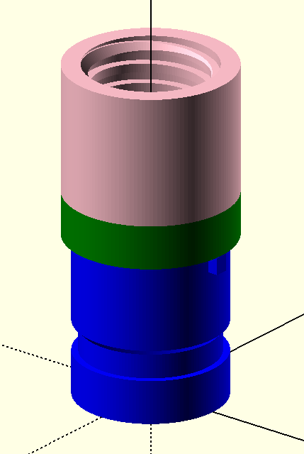
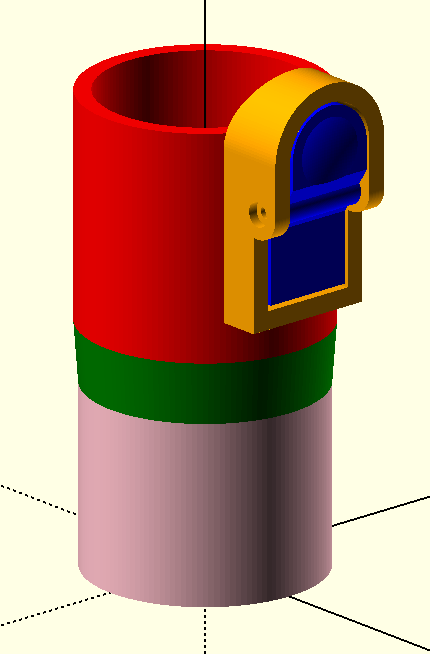
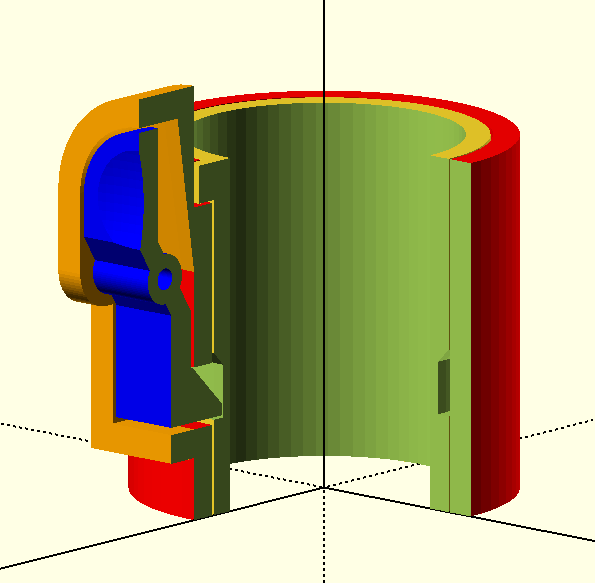
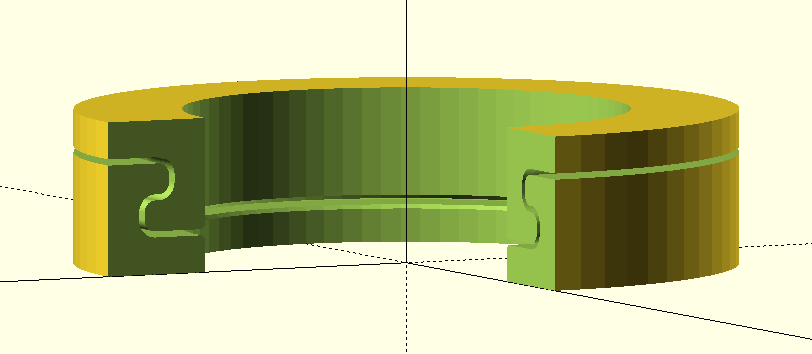
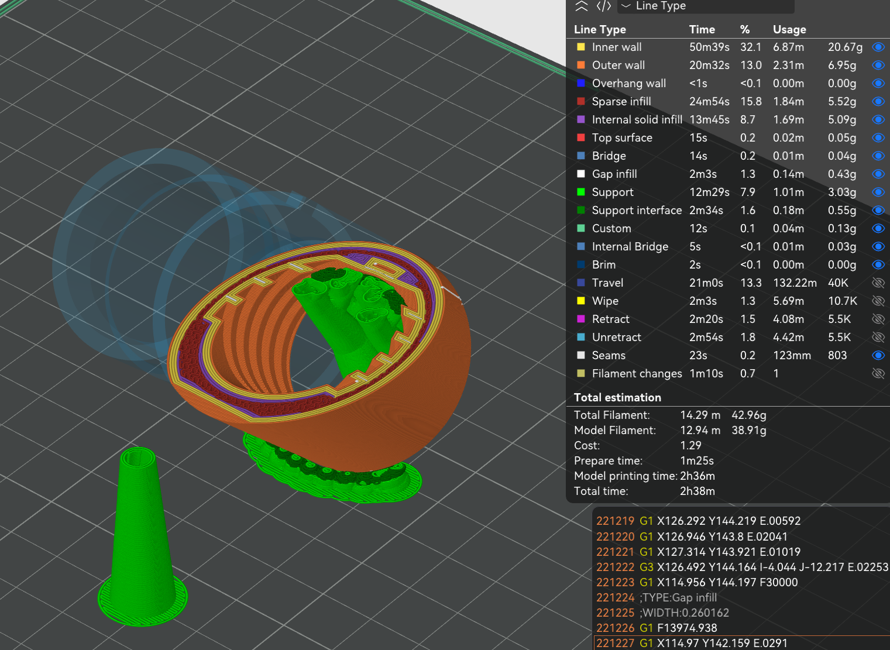
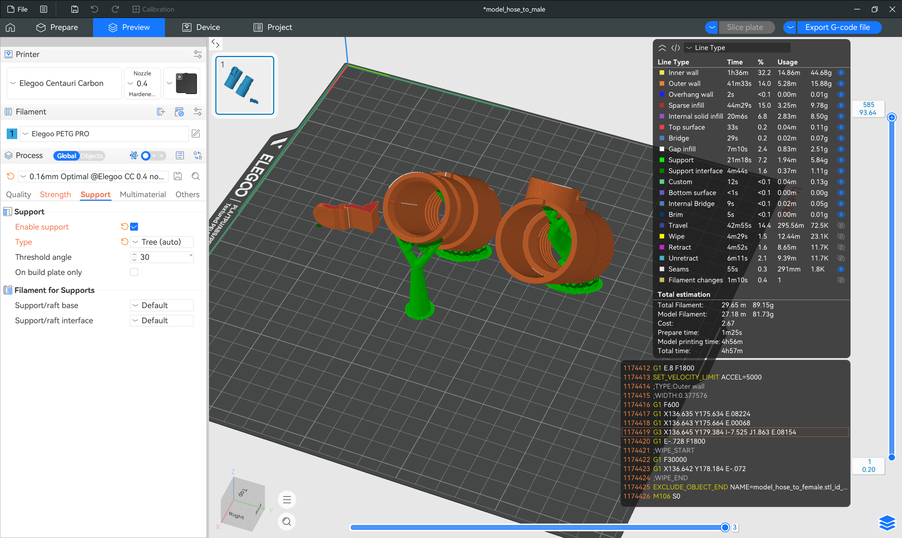

## Parametric CAD files for vacuum hose adapter
- Parameterised OpenSCAD files for Kogan stick vacuum
- ```model_*.scad``` are CAD models which can be opened and rendered into STL files with OpenSCAD version 2026.10.15 (git 5a864f17)
- STL files can be sliced into ```.gcode``` files to be printed by a 3D printer

## Gallery
### OpenSCAD





### Elegoo Slicer

